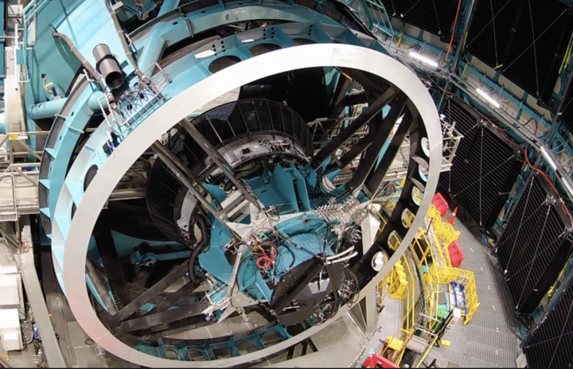

.. |author| replace:: *Danica Zilkova*
.. If there are no contributors, write "none" between the asterisks. Do not remove the substitution.
.. |contributors| replace:: Jacqueline Seron, Kris Mortensen (AI-assisted)

.. Human-only override: safety-critical content.
   This AI-assisted document includes safety-critical content (MTReflector mirror cover
   motion, and internal links).
   Initial draft was reviewed and approved by Kris Mortensen, 2026-11-16.
   The AI-assisted conversion and later edits changed formatting and grammar.
   All safety-critical content is preserved as in the original source.

.. _Simonyi-DayTime-Operations-MTCalSys-Checkout:

##################################
MTCalSys Daily Checkout
##################################

.. _Simonyi-DayTime-Operations-MTCalSys-Checkout-Overview:

Overview
========

The Simonyi Calibration System (MTCalSys) daily checkout validates the
functionality of the LED Projector, Electrometer, Linear Stages,
FiberSpectrographs, and the MTReflector. This procedure runs a sequence of
commands to project and align LEDs with the telescope aperture and confirms
the functionality of the Flatfield system and the Collimated Beam Projector
(CBP).

.. note::
   This procedure does not include the Tunable Laser.

This procedure may be executed at any time during the day, provided that the
MTCalSys is available and the MTReflector is in a safe configuration to open.
It is not necessary for the MTCamera to be available.

The test sequence performs the following:

* Checks relevant Environment Sensor System (ESS) components.
* Enables MTCalSys Commandable Service Components (CSCs).
* Opens the MTReflector.
* Runs a full whitelight single LED source test using the calibration
  projector.
* Parks the projector, closes the MTReflector, and returns the system to a
  safe ``STANDBY`` state.

Report any faults immediately to the calibration team via the
`#calibration-system <https://rubin-obs.slack.com/archives/C081QFRH9C5>`_
channel on Slack.

.. _Simonyi-DayTime-Operations-MTCalSys-Checkout-Preconditions:

Preconditions
=============

* The MTQueue Scheduler must be enabled to run ``add_block.py``.
* Dome cameras must be available to verify reflector movement.
* :file:`ESS:404` and :file:`ESS:405` should normally already be enabled.

.. _Simonyi-DayTime-Operations-MTCalSys-Checkout-Post-conditions:

Post-conditions
===============

* MTCalSys functionality has been verified and is operational.
* CSCs have been returned to the ``STANDBY`` state.

.. _Simonyi-DayTime-Operations-MTCalSys-Checkout-Procedure:

Procedure Steps
===============

1. Verify ESS Components
------------------------

Check that :file:`ESS:404` and :file:`ESS:405` are ``ENABLED``.
These are two temperature sensors for the tunable laser enclosure and the CBP,
respectively, to monitor the thermal stability of each system.

If not, enable them both using :file:`set_summary_state.py`:

.. code-block:: text

   data:
   - [ESS:404, ENABLED]
   - [ESS:405, ENABLED]

.. note::
   The :file:`ESS:404` and :file:`ESS:405` should always be in the enabled
   state.

2. Prepare the Projector
------------------------

Use :file:`maintel/scheduler/add_block.py` with the following configuration:

.. code-block:: text

   id: BLOCK-T601

The `BLOCK-T601 <https://github.com/lsst-ts/ts_config_scheduler/blob/develop/Scheduler/observing_blocks_maintel/BLOCK-T601.json>`_ performs the following:

* Enables CalSys CSCs.
* Opens the MTReflector.
* Setup whitelight flats.

.. dropdown:: BLOCK-T601 Script Details

   .. rubric:: Enable the CalSys CSCs

   Run :file:`set_summary_state.py` with the configuration:

   .. code-block:: text

      data:
      - [LEDProjector, ENABLED]
      - [FiberSpectrograph:101, ENABLED]
      - [FiberSpectrograph:102, ENABLED]
      - [LinearStage:101, ENABLED]
      - [LinearStage:102, ENABLED]
      - [LinearStage:103, ENABLED]
      - [LinearStage:104, ENABLED]
      - [MTReflector, ENABLED]

   .. rubric:: Open the MTReflector

   Run :file:`run_command.py` with the configuration:

   .. code-block:: text

      component: MTReflector
      cmd: open

   This allows light from the calibration projector to reach the camera.

   .. rubric:: Setup the Whitelight Flats
   
   Run :file:`setup_calsys_flats.py`.

.. tip::
   If you cannot use the FlatField Electrometer (``Electrometer:103``),
   you can change the value of ``use_electrometer`` in the script override.
   This only works if you can enable the Electrometer but it fails when
   taking data.

   .. code-block:: text

      override:
          use_electrometer: False

Monitor
^^^^^^^

* Via dome cameras, confirm the reflector has opened.
* MTReflector cover status can be monitored on the `Simonyi Integrated Telemetry <https://summit-lsp.lsst.codes/chronograf/sources/1/dashboards/423?refresh=Paused&lower=now%28%29%20-%2015m>`_ dashboard.

   In-dome camera view of an opened MTReflector. 

3. Run Whitelight Single LED Source Test
----------------------------------------

This step measures each LED with the Electrometer. This script simulates
taking flats, so the use of MTCamera is not required.

Use :file:`maintel/take_calsys_flats_lsstcam.py` with the configuration:

.. code-block:: text

   sequence_names: [
     "whitelight_u_24_M385L3_source",
     "whitelight_i_39_M730L5_source",
     "whitelight_i_39_M810L3_source",
     "whitelight_g_6_M455L4_source",
     "whitelight_g_6_M505L4_source",
     "whitelight_r_57_M565L3_source",
     "whitelight_r_57_M660L4_source",
     "whitelight_z_20_M850L3_source",
     "whitelight_z_20_M940L3_source",
     "whitelight_y_10_M940L3_source",
     "whitelight_y_10_M1050L4_source"
   ]
   config_tcs: False
   use_camera: False
   use_fiberspectrograph_blue: True
   use_fiberspectrograph_red: True
   reason: "whitelight_single_led_source"
   program: "BLOCK-T529"

If you do not want to use the Electrometer, add the following parameter:

.. code-block:: text

   use_electrometer: False

.. note::
   Report any faults to the calibration team.

Monitor
^^^^^^^

* The Linear Stages move to align the LEDs with the telescope aperture.
* Linear Stage positions are logged and can be monitored in `Chronograf In-dome Calibrations <https://summit-lsp.lsst.codes/chronograf/sources/1/dashboards/702?refresh=Paused&lower=now%28%29%20-%2015m>`_. Note that their movement will depend on their starting position; if they can be enabled without any errors, that is acceptable.

4. Shutdown Flatfield Projector
-------------------------------

Use :file:`add_block.py` with the configuration:

.. code-block:: text

   id: BLOCK-T602

The `BLOCK-T602 <https://github.com/lsst-ts/ts_config_scheduler/blob/develop/Scheduler/observing_blocks_maintel/BLOCK-T602.json>`_ performs the following:

* Parks the projector.
* Closes the MTReflector.
* Puts all relevant CSCs to ``STANDBY``.

.. dropdown:: BLOCK-T602 Script Details

   .. rubric:: Parks the projector

   Run :file:`park_calibration_projector.py`.

   .. rubric:: Close the MTReflector

   Run :file:`run_command.py` with the configuration:

   .. code-block:: text

      component: MTReflector
      cmd: close

   .. rubric:: Disable CalSys CSCs

   Run :file:`set_summary_state.py` with the configuration:

   .. code-block:: text

      data:
      - [LEDProjector, STANDBY]
      - [FiberSpectrograph:101, STANDBY]
      - [FiberSpectrograph:102, STANDBY]
      - [LinearStage:101, STANDBY]
      - [LinearStage:102, STANDBY]
      - [LinearStage:103, STANDBY]
      - [LinearStage:104, STANDBY]
      - [MTReflector, STANDBY]

Monitor
^^^^^^^

* Via dome cameras, confirm the reflector has now closed.

   In-dome camera view of a closed MTReflector.

.. _Simonyi-DayTime-Operations-MTCalSys-Checkout-Troubleshooting:
Troubleshooting
===============

* If the MTReflector does not move as commanded, verify dome cameras and check CSC states.
* If any LED alignment fault occurs, report immediately to the calibration team in `#summit-simonyi <https://rubin-obs.slack.com/archives/C07Q45P0PAB>`_.

.. footer::
   Last-modified: 2026-11-16

   Author: Jacqueline Seron
